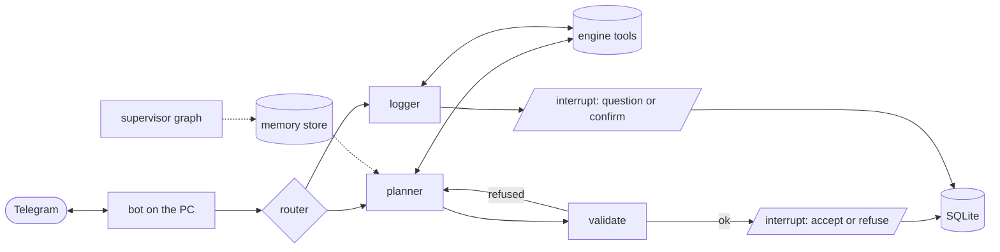

# REPS

> *Reasoning Engine for Personal Strength.* A strength coach built as an agent: a deterministic engine defines what is possible, and a LangGraph agent decides what is good, over weeks, through a Telegram chat, on a local model or on Groq.

REPS is not a plan generator: **it is a loop**. By week 3 the lunges at the end of the workout have cost three missed workouts, and the system changes the plan.

- [TRAINER.md](TRAINER.md): the design
- [ROADMAP.md](ROADMAP.md): what is built and what comes next
- [docs/adr/](docs/adr/): decisions ([ADR-0004](docs/adr/0004-an-agent-graph-over-the-engine-reached-through-telegram.md) is the architecture)

## Status

**`0.5.0` closes the engine-first phase.** It has:
- an enriched catalog and the admissible set;
- plan duration;
- workout logging with provenance, and volume on two axes;
- two tool-loop agents with their evals.

ADR-0004 re-cuts the agent layer as a LangGraph graph reached through Telegram. **Session 6** turns the planner into that graph.

## Architecture (target)



## Getting started

Requires [uv](https://docs.astral.sh/uv/).

```sh
uv sync
uv run trainer db init && uv run trainer db import
uv run trainer enrich derive && uv run trainer enrich curated
cp src/trainer/data/training.example.toml training.toml     # cycle, duration cap, split

uv run trainer catalog --equipment dumbbell
uv run trainer admissible --equipment "body only" --time 45 --exclude "vertical push"
uv run trainer plan --equipment dumbbell                      # the planner graph plans the next workout
uv run trainer log --say "panca bene, solo 3 serie di military"
uv run trainer state
uv run trainer eval --suite plan                              # or --suite log
uv run trainer mcp                                            # the engine's tools over MCP
```

**Choosing the provider.** `trainer plan` runs the planner graph on whichever provider `LLM_BACKEND` names, and copying `.env.example` to `.env` is where that is set.

| `LLM_BACKEND` | what it needs |
|---|---|
| `ollama` (default) | Ollama running, and the model pulled: `ollama pull gpt-oss:20b`. `OLLAMA_MODEL`, `OLLAMA_CONTEXT_LENGTH` and `OLLAMA_BASE_URL` override the rest. |
| `groq` | `GROQ_API_KEY`. `GROQ_MODEL` and `GROQ_MAX_TOKENS` override the rest. |

An unreachable server, a model nobody pulled and a missing key are each reported as a state with the command that fixes it. `trainer log` stays on Groq until session 8 whatever `LLM_BACKEND` names, so it needs `GROQ_API_KEY` either way.

`TRAINER_DB` overrides the database path, which defaults to `trainer.sqlite` in the working directory. `TRAINER_CHECKPOINTS` does the same for the graph's own state, which defaults to `checkpoints.sqlite` and is never the training database.

## Development

```sh
uv run pytest    # offline: conftest.py removes sockets and credentials
uv run mypy      # strict
uv run langgraph dev                  # the planner graph in LangGraph Studio
uv run python -m trainer.coach.probe  # one measured planner run per adverse situation
```

In Studio the planner's input is the request as JSON: `{"request": {"equipment": ["dumbbell"], "budget_min": 45, "groups": ["chest", "arms"]}}`.

## Layout

```
src/trainer/
  engine/     pure library: no LLM, no network, no knowledge of any client
  coach/      the LangGraph agent: the planner graph, its models and run records
  data/       vendored catalog, muscle-group mapping, config example
  tools.py    the tool surface, shared by the agent and the MCP server
  plan.py     the plan's shape, validator and renderer
  log.py      the report's shape and validator
  agent.py    the old tool loop, kept for `trainer log` until session 8
docs/
  adr/        decisions
  enrichment/ vocabulary definitions and hand-decided rows, read by the code
  logging/    the log eval set
  research/   notes behind decisions
```
