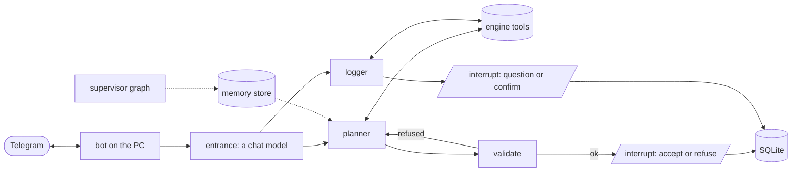

# REPS

> *Reasoning Engine for Personal Strength.* A strength coach built as an agent: a deterministic engine defines what is possible, and a LangGraph agent decides what is good, over weeks, through a Telegram chat, on a local model or on Groq.

REPS is not a plan generator: **it is a loop**. By week 3 the lunges at the end of the workout have cost three missed workouts, and the system changes the plan.

- [TRAINER.md](TRAINER.md): the design
- [ROADMAP.md](ROADMAP.md): what is built and what comes next
- [docs/adr/](docs/adr/): decisions ([ADR-0004](docs/adr/0004-an-agent-graph-over-the-engine-reached-through-telegram.md) is the architecture)

## Status

**`0.7.0` puts the planner on the phone.** On top of `0.6.0`'s planner graph (a LangGraph planner on Ollama or Groq, an emit schema that holds `exercise_id` to today's admissible ids, refusals sent back with every rule they broke, `trainer eval --suite plan` over six invariants), it has:
- `trainer bot`, which long-polls Telegram from the graph's process, answers only the owner and keeps one thread per chat;
- the graph's progress streamed into the chat: the tools it calls and the violations it is sent back;
- a plan with three buttons: *Va bene* writes it as today's prescribed workout (ADR-0005), while *Non mi va* and *Solo 30 minuti* are interrupts that resume the thread with a different plan;
- today's equipment, time and groups taken from `training.toml` and the rotation, the same way for `trainer plan` and the bot;
- a startup check of the selected provider and of Telegram, each failure reported with its fix.

Every message still asks for today's workout: the entrance that talks is session 9 (ADR-0006).

**Session 8** makes it observable: a log file the bot owns, one directory for everything the machine writes, and the run record read back.

## Architecture (target)



## Getting started

Requires [uv](https://docs.astral.sh/uv/).

```sh
uv sync
uv run trainer db init && uv run trainer db import
uv run trainer enrich derive && uv run trainer enrich curated
cp src/trainer/data/training.example.toml ~/.reps/training.toml   # cycle, cap, split, denominator, equipment

uv run trainer catalog --equipment dumbbell
uv run trainer admissible --equipment "body only" --time 45 --exclude "vertical push"
uv run trainer plan                                           # the next workout of the rotation, against what you declared
uv run trainer log --say "panca bene, solo 3 serie di military"
uv run trainer state
uv run trainer eval --suite plan                              # or --suite log
uv run trainer mcp                                            # the engine's tools over MCP
uv run trainer bot                                            # answer Telegram, the owner only
```

**Choosing the provider.** `trainer plan` and `trainer eval --suite plan` run the planner graph on whichever provider `LLM_BACKEND` names, and copying `.env.example` to `.env` is where that is set.

| `LLM_BACKEND` | what it needs |
|---|---|
| `ollama` (default) | Ollama running, and the model pulled: `ollama pull gpt-oss:20b`. `OLLAMA_MODEL`, `OLLAMA_CONTEXT_LENGTH` and `OLLAMA_BASE_URL` override the rest. |
| `groq` | `GROQ_API_KEY`. `GROQ_MODEL` and `GROQ_MAX_TOKENS` override the rest. |

An unreachable server, a model nobody pulled and a missing key are each reported as a state with the command that fixes it. `trainer log` stays on Groq until session 9 whatever `LLM_BACKEND` names, so it needs `GROQ_API_KEY` either way.

**Telegram.** `trainer bot` needs `TELEGRAM_BOT_TOKEN`, which @BotFather issues, and `TELEGRAM_OWNER_ID`, the only user id it answers, which @userinfobot replies with. Both live in `.env`, never in `training.toml`. On Ollama it also needs `OLLAMA_CONTEXT_LENGTH` of at least 8192, and it checks the provider and the token before it starts. It long-polls, so there is no public IP and no tunnel, and one chat is one thread: the conversation survives a restart.

**Everything the machine writes is in one directory**, `~/.reps`, so replacing the laptop is one directory to copy and two terminals are one installation. `TRAINER_HOME` moves it, and each artifact keeps an override that wins over it: `TRAINER_DB` for the training database, `TRAINER_CHECKPOINTS` for the graph's own state (never the training database), `TRAINER_CONFIG` for `training.toml`, and `TRAINER_EVAL_RUNS` for the eval records. `trainer bot` also writes `trainer.log` there, rotated at a megabyte and four files deep, holding every state and every exception and never the token or the owner id. It has no override, because the chat names it by name when a run cannot start or falls over.

## Development

```sh
uv run pytest    # offline: conftest.py removes sockets and credentials
uv run mypy      # strict
uv run langgraph dev                  # the planner graph in LangGraph Studio
```

In Studio the planner's input is the request as JSON: `{"request": {"equipment": ["dumbbell"], "budget_min": 45, "groups": ["chest", "arms"]}}`.

## Layout

```
src/trainer/
  engine/     pure library: no LLM, no network, no knowledge of any client
  coach/      the LangGraph agent: the planner graph, its models and run records
  data/       vendored catalog, muscle-group mapping, config example
  tools.py    the tool surface, shared by the agent and the MCP server
  plan.py     the plan's shape, validator and renderer
  log.py      the report's shape and validator
  agent.py    the old tool loop, kept for `trainer log` until session 9
docs/
  adr/        decisions
  enrichment/ vocabulary definitions and hand-decided rows, read by the code
  logging/    the log eval set
  research/   notes behind decisions
```
