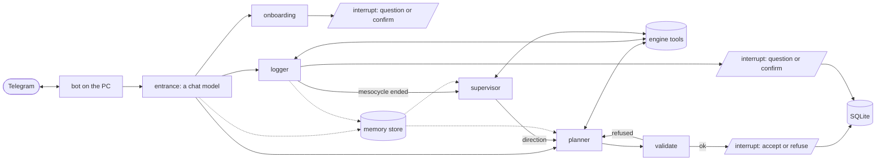

# REPS

> *Reasoning Engine for Personal Strength.* A strength coach built as an agent: a deterministic engine defines what is possible, and a LangGraph agent decides what is good, over weeks, through a Telegram chat, on OpenRouter, Groq or a local model.

REPS is not a plan generator: **it is a loop**. You report a workout in your own words; when that ends a mesocycle, a supervisor reads the ones before it and decides where the next goes, and the planner plans it from there.

- [TRAINER.md](TRAINER.md): the design
- [ROADMAP.md](ROADMAP.md): what is built and what comes next
- [docs/adr/](docs/adr/): decisions ([ADR-0004](docs/adr/0004-an-agent-graph-over-the-engine-reached-through-telegram.md) is the architecture)

## Status

**`0.14.0` adapts this workout to anything you say about it.** Session 15, for `0.15.0`, is built on `main` and not yet released: when a mesocycle ends, a supervisor writes where the next one goes, and the planner plans from it.

## What it does

| You say, in the chat | What happens |
|---|---|
| anything, with nothing declared yet | an interview, one question per message and resumed where you left it: goal, rotation, time, equipment; it ends in a first mesocycle |
| *«cosa faccio oggi?»* | today's workout, read off the mesocycle as the first of the cycle not yet performed, the last load beside each exercise |
| *«panca bene, solo 3 serie di military»* | the logger writes what you did, asking when the words leave a number open |
| that report ends the mesocycle's last cycle | the supervisor writes the next one's direction, the planner plans from it, and it arrives with that direction in a line |
| *«oggi ho 30 minuti»*, *«niente squat»* | this workout adapted, or the mesocycle rewritten; when the words do not say which, it asks *«solo oggi o d'ora in poi?»* |
| *«ho comprato un bilanciere»* | the interview reruns on that alone, a new dated version of your declarations is kept beside the old, and the running mesocycle is kept, rewritten or replaced |
| *«la cyclette mi annoia»* | a conclusion kept with your sentence beside it, refused unless you wrote that sentence; every plan after it reads it as a preference |
| *«quanto petto ho fatto?»* | answered from the engine's read tools |

A plan arrives with buttons: keep or turn down a mesocycle, three for an adapted workout. The validator refuses any plan outside what you declared, and the planner tries again. Nothing the chat says is a fixed line except the two about the machine being in trouble.

## How it works



| Part | What it is |
|---|---|
| engine | a pure library: the catalog, what is admissible, what a workout costs in minutes, the log. No model, no network |
| entrance | the chat model you talk to; it reaches the subgraphs as tools (ADR-0006) |
| planner | plans a mesocycle, or adapts one workout; checked by the validator, accepted by you (ADR-0008) |
| logger | turns a report into a performed workout (ADR-0009) |
| onboarding | the interview that writes your declarations (ADR-0012, ADR-0013) |
| supervisor | between mesocycles: a theme, what changes in exercises, reps or rest, and why, from [variation.md](src/trainer/data/variation.md) and its own past directions (ADR-0014) |

Every node has an eval suite with a bar declared before its first run (ADR-0010): `trainer eval --suite plan`, `log`, `onboard`, `adapt`, `supervise`. Legality is held at 100% by code; judgement is measured.

## Getting started

Requires [uv](https://docs.astral.sh/uv/). Copy `.env.example` to `.env` and fill in a provider's key and the Telegram lines.

```sh
uv sync
uv run trainer db init && uv run trainer db import
uv run trainer enrich derive && uv run trainer enrich curated
uv run trainer bot        # the first message starts the interview
```

**Telegram.** `trainer bot` needs `TELEGRAM_BOT_TOKEN`, from @BotFather, and `TELEGRAM_OWNER_ID`, the only user it answers, from @userinfobot. It long-polls: no public IP, no tunnel. One chat is one thread, and the conversation survives a restart. Every model is checked before it starts.

## The demo

```sh
uv run trainer demo ~/reps-demo
TRAINER_HOME=~/reps-demo uv run trainer bot
```

`trainer demo` builds a home from nothing: the catalog, then three mesocycles performed ([docs/demo/history.toml](docs/demo/history.toml)): hypertrophy, new angles, then strength after the goal changed, the last one workout from its end. In the chat, ask for today's workout and report it: the third mesocycle ends, and the fourth arrives with its direction.

## The command line

```sh
uv run trainer config                                  # what you declared, and when
uv run trainer catalog --equipment dumbbell
uv run trainer admissible --equipment "body only" --time 45 --exclude "vertical push"
uv run trainer plan --mesocycle                        # a workout per slot of the split, kept when accepted
uv run trainer plan                                    # today's workout off it
uv run trainer plan --time 30                          # today's adapted for today only
uv run trainer plan --change "basta affondi"           # the mesocycle rewritten for the cycles left
uv run trainer log --say "panca bene, solo 3 serie di military"
uv run trainer state
uv run trainer eval --suite plan                       # ends with dollars and seconds a run
uv run trainer runs list                               # every negotiation, and what it came to
uv run trainer runs show 20260918-190412-3f9a          # what each run called, spent and reached
uv run trainer mcp                                     # the engine's tools over MCP
```

## Providers and models

`LLM_BACKEND` names the provider, in `.env`.

| `LLM_BACKEND` | what it needs |
|---|---|
| `openrouter` (default) | `OPENROUTER_API_KEY`. Each node runs its measured choice (below). `OPENROUTER_MODEL` moves every node to one model; `OPENROUTER_PROVIDER` pins one host for all. |
| `groq` | `GROQ_API_KEY`. `GROQ_MODEL` and `GROQ_MAX_TOKENS` override the rest. |
| `ollama` | Ollama running and the model pulled: `ollama pull gpt-oss:20b`. `OLLAMA_MODEL`, `OLLAMA_CONTEXT_LENGTH` (at least 8192 for the bot) and `OLLAMA_BASE_URL` override the rest. |

On OpenRouter each node runs the cheapest configuration that cleared its suite's bar ([ADR-0011](docs/adr/0011-each-node-runs-the-cheapest-configuration-that-clears-its-bar.md)):

| Node | Model, effort, host | Measured |
|---|---|---|
| planner | `anthropic/claude-haiku-4.5`, none, Anthropic | 18 of 18 mesocycles, ~$0.13 and ~47 s each |
| logger | `deepseek/deepseek-v4-flash`, high, Parasail | 83% / 92% against 80% / 60%, ~$0.003 and 8-200 s a report |
| onboarding | `deepseek/deepseek-v4-flash`, high, Parasail | 100% held, 96% on time and 100% remembered against 80%, ~$0.0015 and 3-150 s an onboarding |
| entrance | `deepseek/deepseek-v4-flash`, high, Parasail | routed 84% against 80%, plans held 96% against 90%; $0.0003-0.001 and 1-6 s a turn |
| supervisor | `openai/gpt-6-luna`, default, OpenAI | held 88% against 80%, followed 100% against 80%; ~$0.0015 a direction |

**A month costs about $0.5-0.9**: ~300 turns in the chat, ~20 reports and one mesocycle.

`PLANNER_MODEL`, `LOGGER_MODEL`, `ONBOARDING_MODEL`, `SUPERVISOR_MODEL` and `ENTRANCE_MODEL` give a node another model; `_REASONING` another effort (`none`, `low`, `medium`, `high`), checked against what the model takes; `_HOST` another host. `ENTRANCE_BACKEND` puts the entrance on another provider. A missing key, an unreachable server or a model nobody pulled is reported before the run starts, with the command that fixes it.

## Where things live

Everything the machine writes is in `~/.reps`; `TRAINER_HOME` moves it, so replacing the laptop is one directory to copy.

| File | Override | Holds |
|---|---|---|
| `trainer.sqlite` | `TRAINER_DB` | the catalog, declarations, mesocycles, workouts |
| `checkpoints.sqlite` | `TRAINER_CHECKPOINTS` | the graphs' own state; `store.sqlite` beside it is the memory store |
| `runs/` | — | every run, written the moment it ends |
| `eval-runs/` | `TRAINER_EVAL_RUNS` | each eval run's record |
| `trainer.log` | — | every state and exception, never the token or the owner id; rotated at a megabyte, four files deep |

**Every run can be read back.** A *run* is one proposal pursued, to your answer; one ask and all its runs are a *negotiation* (ADR-0007). `trainer runs list` says what each came to: accepted, turned down, refused by the validator, fallen over, cut, waiting, or *opened by the machine* for a next mesocycle. `trainer runs show` prints the tools called, the attempts refused, tokens, seconds per node and dollars charged. It reads documents only, so it works when the provider is what is wrong.

## Development

```sh
uv run pytest         # offline: conftest.py removes sockets and credentials
uv run mypy           # strict
uv run langgraph dev  # the graphs in LangGraph Studio
```

In Studio the planner takes a request: `{"request": {"equipment": ["dumbbell"], "budget_min": 45, "groups": ["chest", "arms"]}}`; the logger a report: `{"report": "panca bene, solo 3 serie di military", "today": "2026-09-18"}`; the entrance a message: `{"messages": [{"role": "user", "content": "cosa faccio oggi?"}]}`, saying which subgraph it would have started.

## Layout

```
src/trainer/
  engine/     pure library: no LLM, no network, no knowledge of any client
  coach/      the LangGraph agent: entrance, planner, logger, onboarding and supervisor graphs, the Telegram bot, the run archive
  data/       vendored catalog, muscle-group mapping, methodology.md and variation.md
  demo.py     the demo's home
  tools.py    the tool surface, shared by the graphs and the MCP server
  plan.py     the plan's shape, validator and renderer
  log.py      the report's shape and validator
docs/
  adr/        decisions
  demo/       the demo's history
  enrichment/ vocabulary definitions and hand-decided rows, read by the code
  logging/ onboarding/ adapting/ supervising/  eval sets and their bars
  research/   notes behind decisions
```
